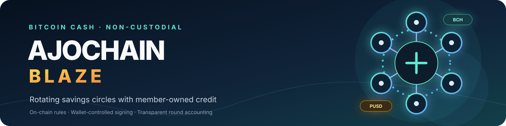

  <strong>Non-custodial rotating savings circles built on Bitcoin Cash.</strong> 
  Wallet-controlled transactions · member-owned credit · on-chain circle state

  <a href="https://ajochain-blaze.vercel.app">Open BLAZE</a> ·
  <a href="https://github.com/Afar88/ajochain-blaze">Source code</a> ·
  <a href="docs/QUICKSTART.md">Ready-to-run guide</a>

---

## What is AjoChain?

**Ajo** (also called esusu) is how millions of people in Nigeria and across Africa save: a small group agrees on an amount, everyone pays in each round, and one member takes the whole pot each round until everyone has had a turn. It runs on trust, and when the person holding the money disappears, everyone loses.

**AjoChain BLAZE puts the circle on Bitcoin Cash.** The money sits in a smart contract (a covenant), not with a person. Each member pays from their own Selene wallet, the payout order is written into the contract, and every deposit and payout is a public transaction anyone can check. The contract rules decide who gets paid and when, not a person holding the cash.

## BCH BLAZE 2026 submission

| | |
|---|---|
| **Track** | Mainnet |
| **Live app** | https://ajochain-blaze.vercel.app |
| **Demo video** | https://youtube.com/shorts/oBRWzLjJwzk |
| **Pitch deck** | [AjoChain BLAZE slides](https://docs.google.com/presentation/d/1ddSZP1gyEL4b3as4AIuswps5a5Pfua5Btf3h8PnAQWY/edit?usp=drivesdk) |
| **BLAZE source code** | https://github.com/Afar88/ajochain-blaze |
| **Pre-BLAZE source code** | https://github.com/Afar88/Ajochain (last commit before the Nov 14, 2026 kickoff: [`069acb5`](https://github.com/Afar88/Ajochain/tree/069acb5)) |
| **Pre-BLAZE demo** | Nov 10, 2026 build, commit [`9f1e15a`](https://github.com/Afar88/Ajochain/commit/9f1e15a11a9bf96c5b596516e4e1af8e9c7f8315): https://ajochain-lhlv8mkqp-destinymomobu-2325s-projects.vercel.app |
| **CashTokens address (EMBER2026)** | `bitcoincash:zr0upm68xfzyu0smvmkr47pr04ywktaetuyxg89wjw` |
| **Mainnet proof** | [docs/MAINNET_PROOF.md](docs/MAINNET_PROOF.md) |

### Mainnet transactions: a full savings circle, start to finish

On Nov 21, 2026, two people ran a real 2-member AjoChain circle on Bitcoin Cash Mainnet from start to finish: 0.002 BCH each per round, 2 rounds, signed in Selene. Every step below is confirmed on chain.

| Step | Block | Transaction |
|---|---:|---|
| Circle token prepared | 978372 | [`a9a3bca6…`](https://blockchair.com/bitcoin-cash/transaction/a9a3bca6406c0c7abacc272f70b78ccca924ca69df9629652d7345bd5647696c) |
| Circle created (genesis) | 978376 | [`a36b90a9…`](https://blockchair.com/bitcoin-cash/transaction/a36b90a9817f1f63105eaa9fc7b1e30ccecba2409a4c8de4a9441fad566b5a80) |
| Round 1: member 1 deposit | 978382 | [`cffa514e…`](https://blockchair.com/bitcoin-cash/transaction/cffa514eaf4dff86d487e1fbdff190286fa58a1c1b103cbb49ac28dea19e9543) |
| Round 1: member 2 deposit | 978384 | [`96a62241…`](https://blockchair.com/bitcoin-cash/transaction/96a622416a45788963f3b135f59bce1d567c64a2abe3e2762d1f532eb00f833a) |
| Round 1 payout: 0.00196 BCH to member 1 | 978385 | [`fd843430…`](https://blockchair.com/bitcoin-cash/transaction/fd8434304adb4d93c83c6079dc57be811a3b0e11b8358a5d61310c01aec60594) |
| Round 2: member 2 deposit | 978386 | [`d1c4fa84…`](https://blockchair.com/bitcoin-cash/transaction/d1c4fa8488d9cc63ede2d745568dc3b54cdb817dea36ff9e2b517654225b4d1c) |
| Final payout: 0.00396 BCH to member 2, contract emptied | 978387 | [`dfc24ec6…`](https://blockchair.com/bitcoin-cash/transaction/dfc24ec6bc58ac04c9dbfa9dd6fed6ebfbd1ecb5c38ad39ad016a7fcba1d34df) |

Full decoded details, plus earlier Mainnet transactions, are in [docs/MAINNET_PROOF.md](docs/MAINNET_PROOF.md).

## For judges: how to try AjoChain

**What you need:** the Selene wallet on your phone, a second wallet address for member 2 (a friend's, or a second Selene wallet), and a little BCH for the deposits and network fees. On Mainnet, start with a small amount per member. To use free test coins instead, pick **Chipnet**.

**Plan for about an hour** for a full 2-member, 2-round circle on Mainnet, mostly waiting for blocks (see the next section). Our own run took about 90 minutes from creation to final payout.

1. **Open** [ajochain-blaze.vercel.app](https://ajochain-blaze.vercel.app) on your phone or laptop and choose **Mainnet** or **Chipnet** at the top.
2. **Connect your wallet.** Tap **Connect wallet**, then scan the QR code with Selene (or tap **Open in Selene** on the same phone) and approve.
3. **Create a circle.** Tap **Create a circle**, pick **BCH**, give it a name, set the amount per member, and paste member 2's address. You are member 1. Check the preview and approve in Selene.
4. **Wait for the first confirmation (about 10 minutes).** The new circle appears in **My circles** once its creation transaction is in a block.
5. **Member 2 finds the circle.** On member 2's wallet, open the app, connect, and tap **Find my circles**. The app reads the blockchain and finds every circle that wallet belongs to. No invite link or server is needed.
6. **Both members deposit.** Open the circle, tap the deposit button, check the amount and approve in Selene. Each deposit needs 1 confirmation before the circle moves on.
7. **Payout.** When everyone has paid in for the round, the payout button opens. A connected member sends it and pays the small network fee; the contract only lets the money go to the member whose turn it is (minus a 1% project fee).
8. **Repeat for round 2.** After the last payout the contract is empty and the circle moves to **Completed**.
9. **Check it on chain.** Every step has a transaction id you can open in any BCH block explorer. Our own completed circle is listed above.

Prefer to watch first? The [demo video](https://youtube.com/shorts/oBRWzLjJwzk) shows the full circle on Mainnet.

## Why some steps take about 10 minutes

Bitcoin Cash adds a new block about **every 10 minutes**. A transaction counts as confirmed once it is inside a block.

AjoChain **waits for 1 confirmation** before it treats a circle or a payment as real. That is on purpose: until a transaction is in a block it could still be replaced or dropped, and a savings circle should never pay out against money that might not arrive. So:

- **A new circle shows in My circles after its first confirmation,** usually within about 10 minutes, sometimes longer if a block is slow.
- **Each deposit and payout also waits for 1 confirmation** before the next step opens. Until then the app shows it as waiting.
- **Public BCH servers can be slow to answer.** The app checks more than one server, but status, balances and the wallet QR code can still take a moment after a refresh. If something looks stuck, wait a minute and refresh.

Nothing is lost while you wait. Your wallet has already signed and sent the transaction; the app is just waiting for the network to confirm it.

## Good to know

- **Cancelled circles show under Completed** in My circles. A circle can only be cancelled before its first payout.
- **The old demo address changed.** https://ajochain.vercel.app was updated on Nov 19, 2026, so it is not a pure pre-BLAZE build. Use the Nov 10, 2026 build in the submission table for the before view.
- **Real money, unaudited contract.** Mainnet uses real BCH. The circle contract hasn't had an independent audit yet. Start with small amounts.

---

## Full step-by-step guide

1. **Get ready.** Install the Selene wallet on your phone. You need BCH for network fees and circle actions. Use Chipnet test BCH to practise, or real BCH on Mainnet.
2. **Open the app.** Go to [ajochain-blaze.vercel.app](https://ajochain-blaze.vercel.app).
3. **Choose a network.** Choose **Chipnet** for testing with no real money, or **Mainnet** for real BCH. Mainnet uses real funds. The circle contract has not had an independent audit, so start with small amounts.
4. **Connect Selene.** Tap Connect wallet, then scan the QR code in Selene or tap **Open in Selene** on your phone. Return to the app and check the connected address in the top bar. Open Wallet details to confirm the receive address Selene currently shows.
5. **Create a circle.** Choose the circle type available on your selected network. Enter its name, contribution amount and the other members' addresses. Your confirmed Selene receive address is **Member 1**. Review the preview before approving anything. The optional **Test sign · no money sent** control is visible beside the main action. It asks Selene to sign, checks the result against the circle rules, then discards it; nothing is broadcast. The helper copy explains this, and a successful check shows **✓ Signature checked · prepare a fresh preview to send**. If the preview expires after 60 seconds, the Test sign control changes to **Refresh preview first**. To create the circle, use the main create/sign-and-send action and approve it in Selene; running Test sign is optional.
6. **Invite members.** Copy the circle invite link and share it with the other members. The link carries circle details, not wallet keys.
7. **Join and deposit.** Open or paste the invite link in BLAZE and add the circle to My circles. Connect the wallet registered for your member slot. Open the circle, prepare the member-deposit preview, check the amount and fees, then sign and send in Selene. A wallet that is not a registered member cannot deposit into that member slot.
8. **Payout or cancel.** A payout can be prepared when the on-chain circle status says it is ready; a connected wallet sponsors the miner fee and the recipient follows the circle's payout order. Cancellation is limited to the registered initiator and is available only before the first payout. The app disables actions that are not currently allowed; follow the reason shown beside the button.
9. **Find your circles.** Open **My circles** and use the **Active** and **Completed** tabs. BLAZE checks eligible circles against blockchain data. Discovery uses your connected wallet's derived address history; saved invite details alone are not proof of membership or payment.
10. **Troubleshoot.** If Selene disconnects, open Wallet and tap **Reconnect**. If a preview is older than 60 seconds, refresh the circle/chain preview and prepare a new one before asking Selene to sign. If the app and Selene are on different networks, switch to the intended network in Selene, then confirm the receive address again in BLAZE.

**Mainnet reminder:** Mainnet uses real BCH. Confirm the network, address, contribution and miner fee in Selene before approving. Start small while the contract has not been independently audited.

## Demo links

- **BLAZE build (live):** https://ajochain-blaze.vercel.app
- **Pre-BLAZE build (Nov 10, 2026 release, commit [`9f1e15a`](https://github.com/Afar88/Ajochain/commit/9f1e15a11a9bf96c5b596516e4e1af8e9c7f8315)):** https://ajochain-lhlv8mkqp-destinymomobu-2325s-projects.vercel.app
- **Pre-BLAZE source (last commit before the Nov 14, 2026 kickoff):** https://github.com/Afar88/Ajochain/tree/069acb5
- **Legacy project's current URL (updated Nov 19, 2026; not a pure pre-BLAZE build):** https://ajochain.vercel.app

---

## More about AjoChain BLAZE

AjoChain BLAZE is a non-custodial savings-circle application for people who want to contribute to a shared rotation and receive payouts according to transparent, enforceable rules.

A circle has an ordered set of members, a contribution amount, a payout order and versioned covenant rules. Members connect a compatible Bitcoin Cash wallet, review transaction details and approve actions in that wallet. BLAZE provides the interface and verification tools; it does not take custody of member keys or act as the source of truth for on-chain payments.

BLAZE supports separate BCH and ParyonUSD (PUSD) workspaces. They use different token and contract paths and must not be treated as interchangeable.

## Product principles

- **The blockchain is the source of truth.** Circle identity, covenant state, receipts, escrow outputs and confirmed payments are derived from Bitcoin Cash transactions and UTXOs—not from a central circle database.
- **Members retain wallet control.** Selene connects through WizardConnect. A connected session is not payment authorization; the user must review and approve wallet actions.
- **Credit belongs to the member.** Each member's receipt/escrow records that member's own contribution credit. One member's surplus does not cover another member's shortfall.
- **Contract versions stay distinct.** Existing Classic, V1, V2 and V3 circles keep the covenant rules and scripts they were created with. A new version does not silently upgrade an old circle.
- **Mainnet is guarded.** A preview, test, local signature check or passing CI run is not approval to move real funds.

## How the system fits together

The browser application connects to the member's wallet and reads chain data through BCH network providers. Circle discovery and circle state come from the blockchain, not a central application backend or database. Optional API routes provide chain-provider reads and additional PUSD signed-transaction preflight; they do not register, store or discover circles.

### On-chain discovery

For discoverable BCH V3 circles on **Chipnet and Mainnet**, discovery is performed from the connected wallet's own derived receive/change address history. BLAZE reads Electrum transaction history, downloads candidate raw transactions, verifies each transaction ID, validates the genesis/category relationship, checks the ordered state and receipt NFTs plus member markers, and rebuilds the exact covenant scripts before accepting a match. A circle is returned only when the connected wallet is one of its members.

There is no central registry, database, server registration or backfill required for discovery on either network. Older circle versions can still be restored using their existing invite links, but invite data is not treated as proof of membership or payment.

The configured Electrum providers are a read quorum, not a substitute for a locally validated SPV/chainwork client. Different endpoint names do not prove independent operators or infrastructure. See [the circle-discovery security gate](docs/BLAZE_CIRCLE_DISCOVERY_BACKEND.md).

## Circle lifecycle and member accounting

The following graphic describes the PUSD V3 circle lifecycle. Its separate Mainnet circle-broadcast path is enabled in code, but code enablement is not independent security approval or a recommendation to send real value before the release gates are met.

### Contribution and payout rules

For the current V3 automatic-reserve design:

1. Genesis creates the circle state NFT, one ordered receipt NFT per member, and one member escrow output per member.
2. A member deposit is credited to that member's own receipt and escrow. The verifier checks the exact member, amount, category and output layout.
3. At payout, every member receipt is debited by exactly one contribution. The project fee is a separate **1% of the gross round pot** (member count × contribution) on every payout, including the final payout.
4. A non-final scheduled recipient carries exactly one next-round contribution into their own receipt/escrow. That reserve is consumed at the next payout; it does not cover later instalments. The final recipient receives no future-round reserve.
5. Before the first payout, the initiator may cancel. Each member's own recorded credit and associated BCH backing are returned according to the covenant. Cancellation is unavailable after the first payout.

Miner fees and CashToken carrier satoshis are accounted for separately from the PUSD project fee. The shared Mainnet fee destination committed by the Mainnet covenant is:

**bitcoincash:zqtu3577x0swy2gsra6km3033xcj8swg8s4rld9w7q**

Read [BCH, PUSD and member accounting](docs/BCH_PUSD_MEMBER_ACCOUNTING.md) for the detailed accounting model and version-specific rules.

## Current feature and release status

| Area | Current state | What that means |
|---|---|---|
| BCH V3 automatic-reserve circles | **Chipnet + Mainnet V3 paths** | Discovery is on-chain on both networks. The dedicated V3 Mainnet signing/broadcast path is separate from the Classic BCH guard; real-wallet and lifecycle validation remains important. |
| Classic / V1 / V2 circles | **Versioned compatibility** | Existing circles retain their original covenant and accounting rules; they are not silently migrated to V3. |
| BCH Mainnet circles | **V3 send path enabled in code** | The dedicated V3 UI and broadcast gates are enabled separately from the Classic BCH operations gate. This is not a blanket audit or release approval for every contract/version. |
| PUSD Mainnet V3 circles | **Separate circle-broadcast path enabled in code** | PRs [#78](https://github.com/Afar88/ajochain-blaze/pull/78) and [#83](https://github.com/Afar88/ajochain-blaze/pull/83) add server-side transaction verification and a durable-ledger-backed, single-relay circle broadcast route for genesis, deposits, payouts and cancellation. This is separate from ordinary PUSD wallet transfers, which remain hard-disabled. Independent contract/security review and operational evidence are still required. |
| Shared circle registry | **Not used** | Neither Chipnet nor Mainnet circle discovery depends on a centralized registry. Circle identity and lifecycle are reconstructed from BCH transactions and UTXOs. |

### PUSD verification status

The PUSD server verifier in [PR #78](https://github.com/Afar88/ajochain-blaze/pull/78) reconstructs the circle and member escrow scripts from the checked-in compiled artifacts, authenticates raw previous transactions against the configured Electrum quorum, validates lifecycle-specific inputs and outputs, checks wallet 0x61 sighashes, and executes the signed transaction using the BCH 2026 VM.

It covers genesis, member deposit, payout (including final close) and pre-first-payout cancellation. **POST /api/pusd/circle/verify** remains read-only and discards signed bytes. PR [#83](https://github.com/Afar88/ajochain-blaze/pull/83) adds the separate **POST /api/pusd/circle/broadcast** route: it re-verifies the exact signed transaction, reserves the inputs in the durable Upstash ledger and relays once. An accepted/already-known relay response is not a BCH confirmation; status and reorganisation checks remain separate.

**Do not confuse the PUSD gates.** The dedicated PUSD V3 circle route has its own code-enabled broadcast gate and durable idempotency ledger. Ordinary PUSD wallet transfers remain hard-disabled by `PUSD_MAINNET_SPENDING_ENABLED = false` and `MAINNET_BROADCAST_ENABLED = false`. The circle route still requires independent review and release evidence before real-value use.

## Get running

The complete [Ready-to-run setup guide](docs/QUICKSTART.md) covers local installation, optional local API setup, tests, Vercel deployment, required environment variables and troubleshooting.

Quick local start:

~~~bash
git clone https://github.com/Afar88/ajochain-blaze.git
cd ajochain-blaze
npm install
npm run dev
~~~

Requirements: Node.js 22 or later and npm. The development command compiles the CashScript artifacts and starts Vite. Development defaults to Chipnet. The repository currently has no npm lockfile, so use npm install rather than npm ci.

Run the core checks:

~~~bash
npm run typecheck
npm test
npm run build
~~~

## Architecture and technology

| Layer | Implementation |
|---|---|
| Web client | React 18, TypeScript, Vite |
| Wallet connection | WizardConnect, including Selene-compatible flows |
| Contracts | CashScript and versioned BCH covenant artifacts |
| Assets | BCH and ParyonUSD CashTokens |
| Chain reads | Electrum Cash providers, raw-transaction and UTXO verification |
| Transaction verification | Libauth BCH 2026 VM checks and exact input/output intent validation |
| API / deployment | Vercel serverless API and the dedicated ajochain-blaze project |

BLAZE is separate from the legacy AjoChain deployment. It has no Neon/PostgreSQL connection and does not use the legacy database as a source of circle identity or payment truth. Browser-local storage is used for local drafts, saved preferences and convenience state; those records are not proof of an on-chain circle or contribution.

## Mainnet proof

The public proof ledger is [docs/MAINNET_PROOF.md](docs/MAINNET_PROOF.md). Every row there was decoded from a public Fulcrum server and matched to its confirmed block. It includes a complete 2-member circle (creation, four deposits, two payouts) on circle contract `bitcoincash:pwczq0uttxcglv59mkgugqhtew4v3zd3rsvulcs4eqjktl8lf9u47h4j2wz4a`.

## Mainnet safety gates

Before any real-value PUSD or BCH circle release, the project still needs:

- Independent security review of the exact covenant source, constructor arguments and compiled artifact hashes.
- Issuer-controlled confirmation of the PUSD category, decimals and token policy.
- Evidence that Electrum providers are independently operated and separated by fault domain; provider quorum alone does not prove independence or validate chainwork locally.
- Real Selene/WizardConnect lifecycle testing with independent member wallets.
- A dedicated, idempotent transaction-submission path, conflict handling, confirmation tracking and reorganisation recovery.
- Monitoring, incident response, rollback procedures and written release-owner approval for the exact deployed commit.

The CI suite includes typechecking, artifact fingerprinting, unit tests, production build and a targeted BCH 2026 VM vector suite. The targeted vector suite is not the complete BCHN/VMB consensus corpus. CI success is necessary engineering evidence, not an external audit or Mainnet launch approval.

See the [BCH 2026 VM compatibility notes](docs/BCH_2026_VM_COMPATIBILITY.md), [Mainnet release checklist](docs/MAINNET_RELEASE_CHECKLIST.md) and [PUSD Mainnet spending checklist](docs/PUSD_MAINNET_RELEASE_CHECKLIST.md).

## Deployment

The active BLAZE application is deployed through the dedicated Vercel project **ajochain-blaze**:

- Application: https://ajochain-blaze.vercel.app
- Repository: https://github.com/Afar88/ajochain-blaze

Keep this project isolated from legacy AjoChain deployments. The optional API adapter uses a BLAZE-specific Electrum provider manifest. No Neon, Postgres, Redis or legacy database is required for on-chain circle discovery. Never put provider credentials in browser variables.

## Built before vs during BLAZE

The BLAZE build has a clear project boundary: **Nov 14, 2026 at 14:00 UTC**.

### Before BLAZE

The pre-BLAZE AjoChain project is [Afar88/Ajochain](https://github.com/Afar88/Ajochain), through commit [`069acb5`](https://github.com/Afar88/Ajochain/commit/069acb55e246a85fbe3ba25736fa34055388c7cc), committed **Nov 14, 2026 at 09:48:47 UTC**—before the 14:00 UTC kickoff. This includes the build week of **Nov 7–14, 2026**. The last public release of that app was deployed on **Nov 10, 2026**.

That work established the earlier AjoChain application, its Chipnet circle experiments, wallet pairing and recovery, V1/V2 circle flows, member accounting groundwork and the original mobile UI.

### During BLAZE

The BLAZE period includes the work in this repository, [Afar88/ajochain-blaze](https://github.com/Afar88/ajochain-blaze), created on **Nov 14, 2026**, plus commits to the original Ajochain repository after the 14:00 UTC kickoff. The old repository's post-kickoff history includes the Nov 14 evening merges for the refreshed V2/legacy create experience, mobile wallet foreground recovery and registry/local-save documentation, followed by the Nov 16 ACR v3 integration and mobile UI refresh.

Commit-history highlights from the BLAZE build include:

- **BCH Mainnet V3 circles**, with guarded circle creation, member deposits and lifecycle actions.
- **On-chain discovery markers** and wallet-derived history scanning, so eligible circles can be found from chain data without a central circle registry or invite link.
- **Selene receive-address picker** and explicit confirmation of the creator's receive address as Member 1.
- **Read-only Electrum quorum verification**, including operator identity requirements and independent Mainnet verification checks.
- **Active and Completed** circle views based on on-chain status.
- **Navy/red theme** and a more readable, responsive mobile-first interface.
- **Stronger WizardConnect wallet recovery**, including saved-session restoration and clearer reconnect states.
- **Optional Test sign checks**: Selene approval verification paths that do not broadcast a payment.

These are engineering and product-history milestones, not an independent security audit. The Mainnet safety gates below still apply.

## Documentation map

- [Ready-to-run setup and deployment](docs/QUICKSTART.md)
- [On-chain circle discovery architecture](docs/BLAZE_CIRCLE_DISCOVERY_BACKEND.md)
- [BCH, PUSD and member accounting](docs/BCH_PUSD_MEMBER_ACCOUNTING.md)
- [PUSD Mainnet release checklist](docs/PUSD_MAINNET_RELEASE_CHECKLIST.md)
- [Mainnet release checklist](docs/MAINNET_RELEASE_CHECKLIST.md)
- [BCH 2026 VM compatibility](docs/BCH_2026_VM_COMPATIBILITY.md)
- [WizardConnect and Selene integration](docs/WIZARDCONNECT_SELENE_PORT.md)
- [Legacy repository and deployment boundaries](docs/LEGACY_REPO_PORTING_AND_DEPLOYMENTS.md)

---

**Safety note:** AjoChain BLAZE is active development software. Treat Chipnet as the test environment. Do not fund prototype contracts or enable Mainnet spending until all required reviews and release gates have been independently completed.
