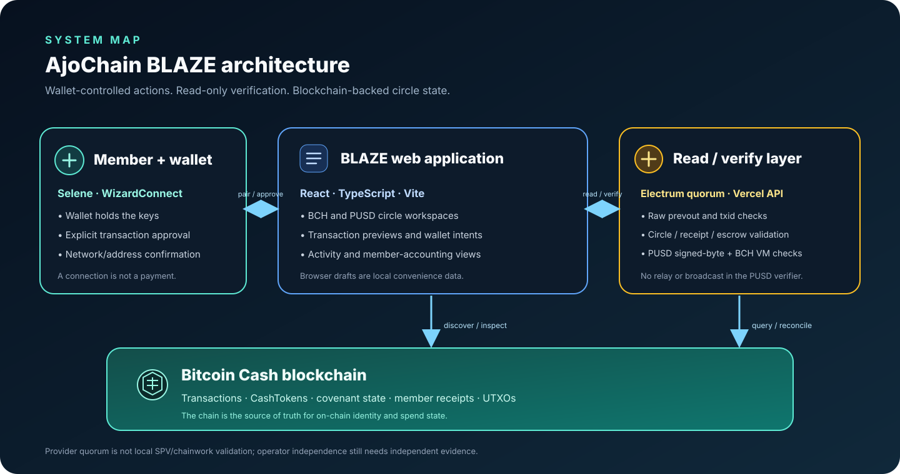
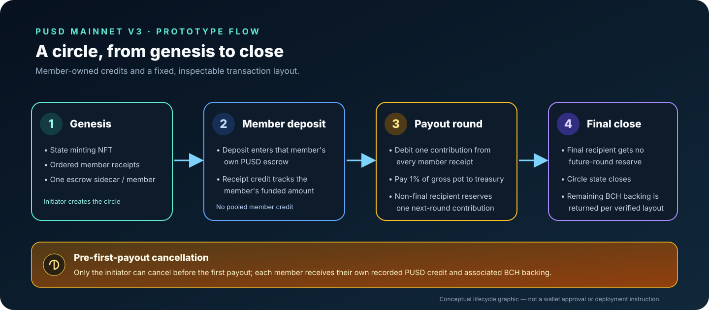

  <strong>Non-custodial rotating savings circles built on Bitcoin Cash.</strong> 
  Wallet-controlled transactions · member-owned credit · on-chain circle state

  <a href="https://ajochain-blaze.vercel.app">Open BLAZE</a> ·
  <a href="https://github.com/Afar88/ajochain-blaze">Source code</a> ·
  <a href="docs/QUICKSTART.md">Ready-to-run guide</a>

---

## What is AjoChain BLAZE?

AjoChain BLAZE is a non-custodial savings-circle application for people who want to contribute to a shared rotation and receive payouts according to transparent, enforceable rules.

A circle has an ordered set of members, a contribution amount, a payout order and versioned covenant rules. Members connect a compatible Bitcoin Cash wallet, review transaction details and approve actions in that wallet. BLAZE provides the interface and verification tools; it does not take custody of member keys or act as the source of truth for on-chain payments.

BLAZE supports separate BCH and ParyonUSD (PUSD) workspaces. They use different token and contract paths and must not be treated as interchangeable.

## Product principles

- **The blockchain is the source of truth.** Circle identity, covenant state, receipts, escrow outputs and confirmed payments are derived from Bitcoin Cash transactions and UTXOs—not from a central circle database.
- **Members retain wallet control.** Selene connects through WizardConnect. A connected session is not payment authorization; the user must review and approve wallet actions.
- **Credit belongs to the member.** Each member's receipt/escrow records that member's own contribution credit. One member's surplus does not cover another member's shortfall.
- **Contract versions stay distinct.** Existing Classic, V1, V2 and V3 circles keep the covenant rules and scripts they were created with. A new version does not silently upgrade an old circle.
- **Mainnet is guarded.** A preview, test, local signature check or passing CI run is not approval to move real funds.

## How the system fits together

The browser application connects to the member's wallet and reads chain data through BCH network providers. The PUSD circle verification API adds a server-side check of the exact signed transaction, its authenticated previous outputs and covenant execution. The API is read-only: it does not relay or broadcast the verified bytes.

### On-chain discovery

For the newer guarded BCH V3 Chipnet circles, discovery is performed from the connected wallet's own derived receive/change address history. BLAZE downloads candidate raw transactions, checks their transaction IDs, validates the genesis/category relationship, verifies the ordered receipt and member markers, and rebuilds the exact covenant scripts before accepting a match.

There is no central registry required to discover these new Chipnet circles. Shared server discovery and registration remain disabled. Older circles can still be restored using their existing invite links.

The configured Electrum providers are a read quorum, not a substitute for a locally validated SPV/chainwork client. Different endpoint names do not prove independent operators or infrastructure. See [the circle-discovery security gate](docs/BLAZE_CIRCLE_DISCOVERY_BACKEND.md).

## Circle lifecycle and member accounting

The following graphic describes the PUSD V3 prototype flow. It is a contract/workflow explanation, not a statement that PUSD Mainnet spending is enabled.

### Contribution and payout rules

For the current V3 automatic-reserve design:

1. Genesis creates the circle state NFT, one ordered receipt NFT per member, and one member escrow output per member.
2. A member deposit is credited to that member's own receipt and escrow. The verifier checks the exact member, amount, category and output layout.
3. At payout, every member receipt is debited by exactly one contribution. The project fee is a separate **1% of the gross round pot** (member count × contribution) on every payout, including the final payout.
4. A non-final scheduled recipient carries exactly one next-round contribution into their own receipt/escrow. That reserve is consumed at the next payout; it does not cover later instalments. The final recipient receives no future-round reserve.
5. Before the first payout, the initiator may cancel. Each member's own recorded credit and associated BCH backing are returned according to the covenant. Cancellation is unavailable after the first payout.

Miner fees and CashToken carrier satoshis are accounted for separately from the PUSD project fee. The shared Mainnet fee destination committed by the Mainnet covenant is:

**bitcoincash:zqtu3577x0swy2gsra6km3033xcj8swg8s4rld9w7q**

Read [BCH, PUSD and member accounting](docs/BCH_PUSD_MEMBER_ACCOUNTING.md) for the detailed accounting model and version-specific rules.

## Current feature and release status

| Area | Current state | What that means |
|---|---|---|
| BCH V3 automatic-reserve circles | **Chipnet prototype** | The guarded V3 path is the active new-circle flow on Chipnet. Its on-chain discovery and member receipt rules are test-network functionality. |
| Classic / V1 / V2 circles | **Versioned compatibility** | Existing circles retain their original covenant and accounting rules; they are not silently migrated to V3. |
| BCH Mainnet circles | **Read-only / preview** | The Mainnet workspace validates drafts and prepares an unsigned genesis preview. Mainnet circle signing and broadcast are not approved. |
| PUSD Mainnet V3 circles | **Engineering / read-only verification** | The workspace and lifecycle planners cover genesis, deposit, payout and pre-first-payout cancellation. PR [#78](https://github.com/Afar88/ajochain-blaze/pull/78) adds server-side signed-byte verification; it does not add a broadcast path or enable spending. |
| Shared circle registry | **Disabled** | BLAZE does not rely on a server registry for new Chipnet V3 discovery. Existing invite restoration remains available. |

### PUSD verification status

The PUSD server verifier in [PR #78](https://github.com/Afar88/ajochain-blaze/pull/78) reconstructs the circle and member escrow scripts from the checked-in compiled artifacts, authenticates raw previous transactions against the configured Electrum quorum, validates lifecycle-specific inputs and outputs, checks wallet 0x61 sighashes, and executes the signed transaction using the BCH 2026 VM.

It covers genesis, member deposit, payout (including final close) and pre-first-payout cancellation. The endpoint is **POST /api/pusd/circle/verify**. It returns verification information only; signed transaction bytes are discarded after the response and are not reserved, relayed or broadcast.

**Verification is not spending approval.** The PUSD Mainnet spending guard remains hard-coded to false, and the Mainnet broadcast guard remains closed. No real PUSD or BCH should be sent to prototype circle scripts.

## Get running

The complete [Ready-to-run setup guide](docs/QUICKSTART.md) covers local installation, optional local API setup, tests, Vercel deployment, required environment variables and troubleshooting.

Quick local start:

~~~bash
git clone https://github.com/Afar88/ajochain-blaze.git
cd ajochain-blaze
npm install
npm run dev
~~~

Requirements: Node.js 22 or later and npm. The development command compiles the CashScript artifacts and starts Vite. Development defaults to Chipnet. The repository currently has no npm lockfile, so use npm install rather than npm ci.

Run the core checks:

~~~bash
npm run typecheck
npm test
npm run build
~~~

## Architecture and technology

| Layer | Implementation |
|---|---|
| Web client | React 18, TypeScript, Vite |
| Wallet connection | WizardConnect, including Selene-compatible flows |
| Contracts | CashScript and versioned BCH covenant artifacts |
| Assets | BCH and ParyonUSD CashTokens |
| Chain reads | Electrum Cash providers, raw-transaction and UTXO verification |
| Transaction verification | Libauth BCH 2026 VM checks and exact input/output intent validation |
| API / deployment | Vercel serverless API and the dedicated ajochain-blaze project |

BLAZE is separate from the legacy AjoChain deployment. It has no Neon/PostgreSQL connection and does not use the legacy database as a source of circle identity or payment truth. Browser-local storage is used for local drafts, saved preferences and convenience state; those records are not proof of an on-chain circle or contribution.

## Mainnet safety gates

Before any real-value PUSD or BCH circle release, the project still needs:

- Independent security review of the exact covenant source, constructor arguments and compiled artifact hashes.
- Issuer-controlled confirmation of the PUSD category, decimals and token policy.
- Evidence that Electrum providers are independently operated and separated by fault domain; provider quorum alone does not prove independence or validate chainwork locally.
- Real Selene/WizardConnect lifecycle testing with independent member wallets.
- A dedicated, idempotent transaction-submission path, conflict handling, confirmation tracking and reorganisation recovery.
- Monitoring, incident response, rollback procedures and written release-owner approval for the exact deployed commit.

The CI suite includes typechecking, artifact fingerprinting, unit tests, production build and a targeted BCH 2026 VM vector suite. The targeted vector suite is not the complete BCHN/VMB consensus corpus. CI success is necessary engineering evidence, not an external audit or Mainnet launch approval.

See the [BCH 2026 VM compatibility notes](docs/BCH_2026_VM_COMPATIBILITY.md), [Mainnet release checklist](docs/MAINNET_RELEASE_CHECKLIST.md) and [PUSD Mainnet spending checklist](docs/PUSD_MAINNET_RELEASE_CHECKLIST.md).

## Deployment

The active BLAZE application is deployed through the dedicated Vercel project **ajochain-blaze**:

- Application: https://ajochain-blaze.vercel.app
- Repository: https://github.com/Afar88/ajochain-blaze

Keep this project isolated from the legacy AjoChain projects and their database resources. The deployment guide documents the BLAZE-only Electrum provider manifest and private Upstash settings. Never put server credentials in browser variables or reuse the legacy database.

## Documentation map

- [Ready-to-run setup and deployment](docs/QUICKSTART.md)
- [Circle discovery backend and security gate](docs/BLAZE_CIRCLE_DISCOVERY_BACKEND.md)
- [BCH, PUSD and member accounting](docs/BCH_PUSD_MEMBER_ACCOUNTING.md)
- [PUSD Mainnet release checklist](docs/PUSD_MAINNET_RELEASE_CHECKLIST.md)
- [Mainnet release checklist](docs/MAINNET_RELEASE_CHECKLIST.md)
- [BCH 2026 VM compatibility](docs/BCH_2026_VM_COMPATIBILITY.md)
- [WizardConnect and Selene integration](docs/WIZARDCONNECT_SELENE_PORT.md)
- [Legacy repository and deployment boundaries](docs/LEGACY_REPO_PORTING_AND_DEPLOYMENTS.md)

---

**Safety note:** AjoChain BLAZE is active development software. Treat Chipnet as the test environment. Do not fund prototype contracts or enable Mainnet spending until all required reviews and release gates have been independently completed.
